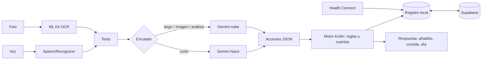

# MacrAI en Android: análisis y plan de migración

> Fecha: octubre de 2026. Rama: `claude/eager-cray-9drsxy`.
> Documento de comportamiento del modelo: [`docs/asistente/comportamiento-chat-macros.md`](asistente/comportamiento-chat-macros.md).

## 0. Resumen

- **Recomendación:** migrar a **Kotlin Multiplatform**, con la app Android en **Jetpack Compose** como primer destino. El núcleo (reglas, cálculos, frontera del día, balance) se escribe en Kotlin común. iOS se puede añadir después con Compose Multiplatform sin reescribir la lógica.
- **IA:** sí se puede usar la IA gratuita del móvil (**Gemini Nano**), pero solo en móviles recientes y con una ventana pequeña. Por eso la arquitectura es **"el modelo interpreta, Kotlin calcula"**. El modelo del dispositivo convierte el mensaje en acciones JSON y el motor aplica las reglas de tu documento. La nube (Gemini, capa gratuita vía Firebase) cubre los móviles sin Nano, los dictados largos y las preguntas de análisis.
- **Lo que gana el móvil, aparte de la IA:** OCR de etiquetas en el dispositivo (gratis y en cualquier Android), dictado por voz del sistema y, sobre todo, **Health Connect**: el peso y el gasto de Samsung Health se leen solos, sin mandar capturas del reloj cada noche.
- **Imagen nueva:** identidad "Libreta" (papel, tinta y un único acento caqui), con el chat como pantalla principal y el día siempre a la vista.
- **Hecho en esta rama:** el núcleo compartido con 31 tests, sacados de los casos reales del documento; el esqueleto de la app Android (chat, Semana, Catálogo, IA híbrida, voz, OCR y Health Connect); y la migración de Supabase `015`.

---

## 1. Qué es MacrAI hoy y qué buscamos

### 1.1 Lo que hay

| Pieza | Estado actual |
|---|---|
| Web | Next.js 14 (App Router) + Tailwind + Radix. Páginas: dashboard, diario, historial, alimentos, objetivos, perfil, chat. |
| Datos | Supabase: `profiles`, `alimentos_global`, `alimentos_usuario`, `consumos`, `objetivos`, `user_llm_keys` (BYOK cifrado), sesiones del bot. |
| Chat | `/api/agent`: un LLM pequeño clasifica la intención en JSON y el servidor hace las cuentas. Va bien encaminado: las cuentas ya no las hace el modelo. |
| LLMs | Cadena de fallback Groq → clave del usuario → Gemini → OpenRouter (`lib/api/llm.ts`). Extracción con `llama-3.1-8b-instant`. |
| Voz / foto | Whisper en Groq; macros desde foto con visión + OCR.space. |
| Telegram | Bot completo (`lib/bot/telegram.ts`, ~1.700 líneas) con su propia lógica y RPC `SECURITY DEFINER`. |

### 1.2 Lo que buscamos (según tu documento de comportamiento)

Una **libreta inteligente** que convierte mensajes cortos, casi siempre dictados y con errores, en registros con macros. Registra primero, enseña cada supuesto y lleva siempre el acumulado del día. Además recuerda el catálogo personal, cruza el peso en ayunas con el gasto del reloj y ayuda a encontrar el mantenimiento real. No hace juicios ni sermones, no usa emojis y los números siempre cuadran.

### 1.3 Distancia entre el código actual y el documento

| Regla del documento | Comportamiento actual | Consecuencia |
|---|---|---|
| Registra primero, pregunta después (regla 1) | Si hay varias coincidencias, enseña opciones (`food_options`) y espera confirmación | Un mensaje de más en el caso más común |
| El día no cambia a medianoche (§2.11) | `fecha = new Date().toISOString()`: día en **UTC** del servidor | A la 1:30 en España a veces sigue en el día anterior y a veces no, según el horario de verano |
| Comida = la del último registro (§4) | Ventana fija de 90 min y después pregunta | Pregunta por la comida, que el documento prohíbe |
| Peso, gasto, balance, mantenimiento (§9-10) | No existen | La mitad del valor del documento no tiene soporte |
| Catálogo con fuente, marca, formato, peso unitario y alias (§5-7, apéndices) | Solo nombre y macros (por 100 g o por unidad) | No distingue "ketchup light" de "ketchup Salseo" ni sabe qué es etiqueta y qué estimación |
| Cinco comidas; lo de después de cenar va a cena (§4) | Siete tipos, con `snack` y `otro` | Totales repartidos en categorías que el usuario no usa |
| Respuesta fija: añadido → comida → día con las 5 comidas (§11) | Tarjetas distintas según la acción | El usuario pidió el acumulado del día siempre |

---

## 2. Plataforma: opciones y decisión

| Opción | A favor | En contra |
|---|---|---|
| **Kotlin Multiplatform + Compose** (recomendada) | Acceso directo a Gemini Nano, ML Kit, Health Connect y SpeechRecognizer. El núcleo se comparte con iOS (y con JS o Wasm si hace falta). Compose Multiplatform ya es estable en iOS. | Se reescribe la UI. Hay que pasar la lógica de TS a Kotlin (ya está hecho en el núcleo de esta rama). |
| Kotlin solo Android | Lo más simple para empezar | Cierra la puerta a iOS; KMP cuesta casi lo mismo si el núcleo se separa desde el principio |
| Capacitor / TWA envolviendo la web actual | Se reaprovecha casi todo. Existe un plugin de Capacitor para la Prompt API de ML Kit. | Health Connect, voz y OCR van por plugins de terceros; la experiencia sigue siendo web y el chat depende del servidor |
| Flutter / React Native | Multiplataforma maduro | Gemini Nano y Health Connect por puentes nativos; otro lenguaje que no comparte nada con la web ni con Android |

**Decisión:** KMP. El módulo `shared` no tiene dependencias de plataforma; Android lo consume por su target JVM y iOS lo hará por los targets nativos. La UI de Android se escribe ya en Compose, con la misma API que Compose Multiplatform, así que llevarla a iOS es sobre todo mover archivos.

---

## 3. La IA gratuita de Android: qué hay de verdad

### 3.1 Piezas disponibles

| Pieza | Qué hace | Dónde funciona | Coste |
|---|---|---|---|
| **Gemini Nano** (Prompt API de ML Kit GenAI, alpha) | Prompts libres de texto, más una imagen | Móviles con AICore: Pixel 9 y 10, Galaxy S25 y S26 y otros recientes (Honor, OnePlus, OPPO, Xiaomi, vivo…). Rinde mejor en Pixel 10 (nano-v3). | Gratis, sin red |
| **Firebase AI Logic, modo híbrido** (experimental, abril de 2026) | Una sola API: `PREFER_ON_DEVICE` usa Nano y, si no hay, la nube | Todos los móviles | Nano gratis; la nube con la capa gratuita de la Gemini Developer API |
| **ML Kit Text Recognition v2** | OCR de etiquetas y capturas | Cualquier Android | Gratis, sin red |
| **SpeechRecognizer** del sistema | Dictado en `es-ES`, en el dispositivo si el idioma está descargado | Cualquier Android | Gratis |
| **Health Connect** | Lee peso, calorías totales y pasos que escribe Samsung Health | Android 9+ (integrado en Android 14+) | Gratis |

### 3.2 Límites que condicionan el diseño

- **Cobertura:** Nano solo existe en una parte de los móviles. La app tiene que funcionar igual de bien sin él.
- **Ventana pequeña:** guías de terceros hablan de ~4.000 tokens de entrada y una salida corta; Google no publica una cifra en las páginas consultadas, así que hay que medirlo en el dispositivo. Tu documento ocupa unos 12.000 tokens: **no cabe en Nano**.
- **Un turno y una imagen:** el modelo local no lleva conversación. Por eso el prompt de extracción incluye la pregunta pendiente ("¿Cuántos gramos de leche?") para que un "150" suelto tenga sentido.
- **Primer plano y cuotas:** AICore solo atiende a la app visible y devuelve `BUSY` si se pasa de cuota. Nada de procesar en segundo plano.
- **APIs en alpha o experimentales:** los nombres pueden cambiar, así que toda la dependencia queda en un archivo (`HybridLanguageModel.kt`).

### 3.3 Consecuencia: "el modelo interpreta, Kotlin calcula"

Tu documento tiene 12 reglas. La mayoría no necesita un modelo: son reglas deterministas, y en código se cumplen siempre.

| Regla | Dónde vive ahora |
|---|---|
| 1. Registra primero | Motor: nunca bloquea; solo pregunta si falta la cantidad y no hay valor por defecto |
| 2. Forma fija de respuesta | `Reply.kt`: estructura de bloques; la UI y el Markdown salen de ahí |
| 3. Todo supuesto se ve | `Items.kt`: cada decisión (hueso, unidad, ml≈g, paquete compartido) añade su línea |
| 4. La etiqueta manda | Cascada en `chooseProfile` |
| 5. El contexto decide comida y día | `LogDay.kt`: `resolveLogDay` y `resolveMeal` |
| 6. Corregir cuesta un mensaje | Correcciones con tabla antes → ahora y recálculo desde las entradas |
| 7. Si delega, decide | Prompt: el modelo estima (`estimacion_100`) y el motor lo marca como estimación |
| 8. Dato raro: avisa una vez | `plausibility` + `notedOnce` |
| 9. Cero juicios | Las respuestas de registro no pasan por el modelo: no hay sitio para "un día muy calórico" |
| 10. Los números cuadran | `Nutrition.kt`: 4P + 4C + 9G, sumas desde las entradas y redondeo único |
| 11. Mismo nombre ≠ mismo producto | `mergeLabelIntoCatalog`: compara con lo que dijo el usuario y nunca sobrescribe |
| 12. Una pregunta, al final | `Turn.ask` guarda solo la primera |

El modelo solo hace lo que no se puede programar: entender un dictado sucio ("anillo de 35 de ketchup light"), separar un dictado largo por comidas, leer una etiqueta desordenada, estimar un plato casero y responder preguntas de razonamiento.

### 3.4 Enrutado

| Tarea | Modelo |
|---|---|
| Mensaje corto (≤220 caracteres) | Gemini Nano si está; si no, nube (Flash-Lite) |
| Etiqueta con foto | OCR en el dispositivo → texto a Nano |
| Foto de un plato o captura sin texto legible | Nube con imagen |
| Dictado de un día entero | Nube (la salida JSON no cabe en Nano) |
| Nano devuelve algo que no es JSON válido | Reintento en la nube |
| "¿Está bien planteado?", "¿vamos bien?" | Nube, con el documento entero como system prompt y los datos calculados por el motor |

---

## 4. Arquitectura

```
mobile/
├── shared/                 Kotlin común, sin Android: se prueba en JVM
│   ├── Models.kt           Comidas, macros, perfiles con fuente, entradas, peso, gasto
│   ├── Nutrition.kt        4P+4C+9G, plausibilidad, redondeo
│   ├── LogDay.kt           Frontera del día y asignación de comida
│   ├── FoodMatch.kt        Emparejado tolerante a errores de voz
│   ├── Items.kt            Cascada de alimentos y cantidades (hueso, sobras, compartido)
│   ├── Balance.kt          Déficit, semana, peso y mantenimiento
│   ├── Actions.kt          Esquema JSON que produce el modelo
│   ├── Prompts.kt          Prompt compacto (Nano) y de razonamiento (nube)
│   ├── Assistant.kt        Motor: aplica acciones y compone la respuesta
│   ├── Reply.kt            Bloques de respuesta y su Markdown
│   └── Store.kt            Interfaz de persistencia
└── androidApp/             Compose + Firebase AI + ML Kit + Health Connect
    ├── ai/HybridLanguageModel.kt
    ├── input/LabelOcr.kt, SpeechInput.kt
    ├── health/HealthConnectSource.kt
    ├── data/FileMacroStore.kt   (fase 1; Room + Supabase en fase 2)
    └── ui/                      Hoy (chat), Semana, Catálogo, tema
```



**Backend:** Supabase sigue siendo la fuente de verdad sincronizada. La app trabaja sin red y sincroniza al recuperar la conexión. Las claves de la IA dejan de vivir en un servidor propio: Firebase AI Logic, protegido con App Check, llama a Gemini sin meter ninguna API key en el APK.

---

## 5. Modelo de datos

Migración [`supabase/migrations/015_android_core_model.sql`](../supabase/migrations/015_android_core_model.sql). Es aditiva: la web y el bot siguen funcionando.

| Cambio | Para qué (sección del documento) |
|---|---|
| `alimentos_usuario`: `marca`, `fuente` (etiqueta/usuario/web/estimación), `macros_estimados`, `base` (100 g/100 ml), `columna` (tal cual/preparado/escurrido), `peso_unidad_g`, `formato_envase` | §5, §6, §7, apéndice A |
| `alimentos_alias` | Apéndice B: "la de Mercadona", "el batido" |
| `consumos`: `fuente`, `supuestos[]`, `provisional`, `solo_kcal`, `cantidad_dicha_gr`, `client_id` | Supuestos visibles, etiqueta pendiente, cenas a ojo, "ya era sin hueso", sincronización sin duplicados |
| `consumos.fecha` pasa a significar **día de registro** | §2.11 |
| `pesajes`, `gasto_diario`, `dias_cerrados` | §9, §10 |
| `profiles`: `dia_abierto`, `deficit_objetivo_kcal`, `proteina_g_por_kg`, `lesion_activa` | §13, §15 |

Los tipos `snack` y `otro` se quedan en la base por compatibilidad. La app los muestra dentro de la cena.

---

## 6. Nueva imagen y UX

### 6.1 Concepto: "Libreta"

El documento describe una libreta que calcula, no una app de gimnasio. La imagen nueva sale de ahí: papel cálido, tinta casi negra y **un único acento caqui**. Se dejan el lima eléctrico y la estética de dashboard deportivo. No hay degradados, confeti, emojis ni verdes de "bien hecho": el tono visual es el mismo que pide el §12.

| Token | Claro | Oscuro | Uso |
|---|---|---|---|
| Papel (fondo) | `#F5F2EB` | `#111214` | Fondo de la app |
| Superficie | `#FFFDF8` | `#1A1C1F` | Tarjetas de respuesta |
| Hundido | `#ECE8DE` | `#0B0C0D` | Tabla del día, chips vacíos |
| Tinta | `#16181B` | `#F1EEE6` | Texto y cifras |
| Tinta suave | `#62666D` | `#A2A5AB` | Supuestos, etiquetas |
| Línea | `#DDD8CC` | `#2A2D31` | Bordes finos (la profundidad sale de aquí, no de sombras) |
| Acento caqui | `#FF6A3D` con tinta encima | igual | Micrófono, pregunta final, insignia "E" |
| Proteína / Carbos / Grasas | `#2F5FD0` / `#B7791F` / `#8A4FD3` | `#8FB0FF` / `#F2C05C` / `#C9A4FF` | Siempre los mismos colores para lo mismo |

**Regla del acento:** siempre como relleno con tinta encima (contraste ~7:1). Nunca texto caqui sobre papel.
**Tipografía:** la del sistema, con **cifras tabulares** en todas las tablas para que las columnas cuadren. Se puede añadir Manrope como fuente propia en `res/font` sin tocar los componentes.

### 6.2 Pantallas

| Pantalla | Qué hay | Sustituye en la web a |
|---|---|---|
| **Hoy** (principal) | La **tira del día** fija arriba (día de registro abierto o cerrado, kcal, proteína frente al mínimo y las 5 comidas), la conversación y el compositor | Dashboard, Diario, Chat |
| **Semana** | Balance contra el reloj, peso en ayunas con su media, estimación del mantenimiento y botón de importar de Health Connect | Historial, Objetivos |
| **Catálogo** | Alimentos con su insignia de fuente (E/U/Web/Est), búsqueda tolerante a errores, peso unitario | Alimentos |
| Ajustes (fase 2) | Perfil (§15), objetivo de déficit, cuenta y sincronización | Perfil |

### 6.3 Componentes clave

- **Ticket de respuesta:** mantiene el orden fijo del §11.1 (título → supuestos → alimentos → comida → día → pregunta). Los supuestos van en gris con una línea al margen: se ven, pero no compiten con las cifras. La pregunta final lleva una barra caqui: es lo único que pide acción.
- **Tabla del día:** las 5 comidas siempre, con guion en las vacías, y "parcial" o "FINAL" en la cabecera.
- **Insignias de fuente:** `E` (etiqueta) en caqui; `U`, `Web` y `Est` en gris. El usuario ve de un vistazo qué es dato y qué es estimación.
- **Tabla de corrección:** antes → ahora, con una línea de conclusión ("las calorías casi no cambian, pero los carbos suben 7,5 g").
- **Compositor centrado en la voz:** con el campo vacío, el botón grande es el micrófono; con texto, se convierte en enviar. La cámara ofrece "Foto de la etiqueta" y "Captura del reloj o galería".

---

## 7. Plan por fases

### Fase 0 — Fundamentos (hecho en esta rama)

- [x] Documento de comportamiento en el repo como fuente única del system prompt
- [x] Núcleo `shared` con las reglas del documento y 31 tests con casos reales (frontera del día, nectarina, helado de madrugada, fila desplazada del queso crema, Pepero, hueso, ketchup de otra marca, balance, mantenimiento)
- [x] App Android: tema "Libreta", Hoy, Semana, Catálogo, IA híbrida, OCR, voz, Health Connect, registro local
- [x] Migración Supabase `015`

### Fase 1 — Primera build en un móvil real (1-2 semanas)

- Crear el proyecto de Firebase, activar AI Logic con la Gemini Developer API y App Check, y descargar `google-services.json`.
- Compilar en Android Studio. Este entorno no tiene acceso al Maven de Google, así que el módulo Android **no se ha podido compilar aquí**: hay que esperar algún ajuste de imports, sobre todo en la API híbrida experimental.
- **Evaluación de extracción:** convertir los ejemplos de tu documento (y del historial real) en un juego de ~100 mensajes con su JSON esperado, y medir Nano frente a la nube. Si Nano falla en algo concreto, se ajustan los ejemplos del prompt o esa tarea pasa a la nube.
- Probar Health Connect con Samsung Health y comparar con las capturas del reloj.

### Fase 2 — Cuenta y sincronización (2-3 semanas)

- Inicio de sesión con Supabase (`supabase-kt` + Credential Manager con Google).
- Base local con Room (KMP) o SQLDelight en lugar del JSON; sincronización con `client_id` contra Supabase.
- Importar el catálogo actual del usuario y sus consumos.
- Pantalla de Ajustes con el contexto personal (§15).

### Fase 3 — Telegram y web

- Opción A: compilar el núcleo `shared` a JS o Wasm (KMP lo permite) y usarlo en una Edge Function de Supabase para el bot. Las reglas serían las mismas en todas partes.
- Opción B: dejar el bot y la web en modo lectura y retirarlos cuando la app esté asentada.
- En cualquier caso, la lógica de `lib/bot/telegram.ts` no debería seguir evolucionando por su cuenta.

### Fase 4 — iOS (opcional)

- Llevar la UI a Compose Multiplatform y añadir los targets de iOS que ya declara `shared`.
- En el iPhone, el modelo del dispositivo sería Apple Foundation Models, detrás de la misma interfaz `LanguageModel`.
- Health Connect pasa a ser HealthKit.

---

## 8. Riesgos y decisiones abiertas

| Riesgo | Mitigación |
|---|---|
| La calidad de Nano en español con dictados sucios no está medida | Evaluación de la fase 1; reintento automático en la nube; ejemplos reales en el prompt |
| Las APIs de Nano y del modo híbrido son alpha o experimentales | Todo en `HybridLanguageModel.kt`; la nube como camino por defecto si cambian |
| La sincronización de Samsung Health con Health Connect a veces llega tarde o incompleta | La captura del reloj sigue funcionando (OCR + acción `gasto`); prevalece el último dato |
| Cuotas de la capa gratuita de Gemini | Nano absorbe la mayoría de mensajes cortos en móviles compatibles; spend cap en Firebase |
| Doble lógica mientras convivan la web y el bot | Fase 3: el núcleo compartido en JS o retirada |

**Decisiones que te tocan:**

1. ¿iOS entra en el plan o nos quedamos en Android?
2. ¿El bot de Telegram se mantiene (opción A) o se retira (opción B)?
3. ¿Es una app solo para ti o la quieres publicar? Cambia el onboarding, la privacidad de Health Connect y las cuotas.

---

## 9. Cómo compilar

```bash
cd mobile
# Tests del núcleo (no necesitan Android)
./gradlew :shared:jvmTest
# App: abrir mobile/ en Android Studio, añadir androidApp/google-services.json y ejecutar
```

El wrapper de Gradle (8.14.3) va incluido. Los tests del núcleo se han ejecutado con él en verde; la build de `androidApp` está pendiente de la fase 1.

## Fuentes

- [ML Kit Prompt API (blog de Android Developers)](https://developer.android.com/blog/posts/ml-kit-s-prompt-api-unlock-custom-on-device-gemini-nano-experiences)
- [Inferencia híbrida en Android](https://developer.android.com/ai/hybrid) y [anuncio de abril de 2026](https://developer.android.com/blog/posts/experimental-hybrid-inference-and-new-gemini-models-for-android)
- [Referencia de `OnDeviceConfig` (Firebase)](https://firebase.google.com/docs/reference/kotlin/com/google/firebase/ai/OnDeviceConfig)
- [Guía de terceros sobre límites de Gemini Nano](https://atomicrobot.com/blog/can-i-eat-it-using-gemini-nano/)
- [Plugin de Capacitor para la Prompt API](https://capawesome.io/docs/sdks/capacitor/mlkit/genai-prompt/)
- [Foro de Samsung: fiabilidad de la sincronización con Health Connect](https://forum.developer.samsung.com/t/syncing-data-is-unreliable-between-samsung-health-and-health-connect/24850)
