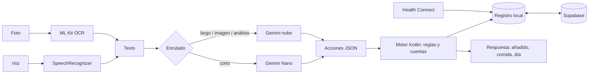

# MacrAI en Android: análisis y plan de migración

> Fecha: octubre de 2026.
> Documento de comportamiento del modelo: [`docs/asistente/comportamiento-chat-macros.md`](asistente/comportamiento-chat-macros.md).
> Alcance: solo Android, publicada en Google Play para cualquier usuario, empezando por ti. Sin iOS y sin Telegram.

## 0. Resumen

- **Plataforma:** app **Android nativa en Kotlin y Jetpack Compose**. Las reglas, los cálculos, la frontera del día y el balance van en un módulo `core` de Kotlin puro, sin Android, que se prueba en segundos en la JVM.
- **IA:** sí se puede usar la IA gratuita del móvil (**Gemini Nano**), pero solo en móviles recientes y con una ventana pequeña. Por eso la arquitectura es **"el modelo interpreta, Kotlin calcula"**. El modelo del dispositivo convierte el mensaje en acciones JSON y el motor aplica las reglas de tu documento. La nube (Gemini vía Firebase) cubre los móviles sin Nano, los dictados largos y las preguntas de análisis.
- **Lo que gana el móvil, aparte de la IA:** OCR de etiquetas en el dispositivo (gratis y en cualquier Android), dictado por voz del sistema y, sobre todo, **Health Connect**: el peso y el gasto de Samsung Health se leen solos, sin mandar capturas del reloj cada noche.
- **Imagen nueva:** identidad "Libreta" (papel, tinta y un único acento caqui), con el chat como pantalla principal y el día siempre a la vista.
- **Publicar para otros:** cambia tres cosas respecto a una app personal: cuentas y datos por usuario, la nube de pago (la capa gratuita se comparte entre todos los usuarios y Google puede usar esos datos) y los requisitos de Google Play para apps de salud (§7).
- **Hecho en esta rama:**
  - el núcleo, con 54 tests sacados de los casos reales del documento;
  - la app Android: chat, Semana, Catálogo, Ajustes, IA híbrida, voz, OCR, código de barras, Health Connect y edición manual;
  - cuentas y sincronización con Supabase, que comparte datos con la web;
  - el catálogo global de supermercados, con su importador semanal;
  - las migraciones `015`–`017`, probadas en PostgreSQL;
  - la retirada de Telegram.

---

## 1. Qué es MacrAI hoy y qué buscamos

### 1.1 Lo que hay

| Pieza | Estado actual |
|---|---|
| Web | Next.js 14 (App Router) + Tailwind + Radix. Páginas: dashboard, diario, historial, alimentos, objetivos, perfil, chat. |
| Datos | Supabase: `profiles`, `alimentos_global`, `alimentos_usuario`, `consumos`, `objetivos`, `user_llm_keys` (BYOK cifrado). |
| Chat | `/api/agent`: un LLM pequeño clasifica la intención en JSON y el servidor hace las cuentas. Va bien encaminado: las cuentas ya no las hace el modelo. |
| LLMs | Cadena de fallback Groq → clave del usuario → Gemini → OpenRouter (`lib/api/llm.ts`). Extracción con `llama-3.1-8b-instant`. |
| Voz / foto | Whisper en Groq; macros desde foto con visión + OCR.space. |
| Telegram | **Retirado en esta rama**: el bot, sus rutas y el banner de la web; la migración `016` borra sus tablas, funciones y columnas. |

### 1.2 Lo que buscamos (según tu documento de comportamiento)

Una **libreta inteligente**, para ti y para cualquier usuario, que convierte mensajes cortos, casi siempre dictados y con errores, en registros con macros. Registra primero, enseña cada supuesto y lleva siempre el acumulado del día. Además recuerda el catálogo personal, cruza el peso en ayunas con el gasto del reloj y ayuda a encontrar el mantenimiento real. No hace juicios ni sermones, no usa emojis y los números siempre cuadran.

### 1.3 Distancia entre el código actual y el documento

| Regla del documento | Comportamiento actual | Consecuencia |
|---|---|---|
| Registra primero, pregunta después (regla 1) | Si hay varias coincidencias, enseña opciones (`food_options`) y espera confirmación | Un mensaje de más en el caso más común |
| El día no cambia a medianoche (§2.11) | `fecha = new Date().toISOString()`: día en **UTC** del servidor | A la 1:30 en España a veces sigue en el día anterior y a veces no, según el horario de verano |
| Comida = la del último registro (§4) | Ventana fija de 90 min y después pregunta | Pregunta por la comida, que el documento prohíbe |
| Peso, gasto, balance, mantenimiento (§9-10) | No existen | La mitad del valor del documento no tiene soporte |
| Catálogo con fuente, marca, formato, peso unitario y alias (§5-7, apéndices) | Solo nombre y macros (por 100 g o por unidad) | No distingue "ketchup light" de "ketchup Salseo" ni sabe qué es etiqueta y qué estimación |
| Cinco comidas; lo de después de cenar va a cena (§4) | Siete tipos, con `snack` y `otro` | Totales repartidos en categorías que el usuario no usa |
| Respuesta fija: añadido → comida → día con las 5 comidas (§11) | Tarjetas distintas según la acción | El usuario pidió el acumulado del día siempre |

---

## 2. Plataforma: opciones y decisión

| Opción | A favor | En contra |
|---|---|---|
| **Kotlin + Compose, solo Android** (elegida) | Acceso directo a Gemini Nano, ML Kit, Health Connect y SpeechRecognizer. Un solo lenguaje y una sola build. | Se reescribe la UI y la lógica pasa de TS a Kotlin (el núcleo ya está hecho en esta rama). |
| Kotlin Multiplatform | Permitiría iOS más adelante | Sin iOS en el plan solo añade complejidad de build. Como `core` no depende de Android, convertirlo en KMP más tarde es barato. |
| Capacitor / TWA envolviendo la web actual | Se reaprovecha casi todo. Existe un plugin de Capacitor para la Prompt API de ML Kit. | Health Connect, voz y OCR van por plugins de terceros; la experiencia sigue siendo web y el chat depende del servidor. |
| Flutter / React Native | Multiplataforma maduro | Gemini Nano y Health Connect por puentes nativos; otro lenguaje sin ventaja si solo hay Android. |

**Decisión:** Kotlin nativo con dos módulos. `core` es Kotlin puro (JVM): todas las reglas del documento, probadas sin emulador. `androidApp` es Compose más las piezas del sistema (IA, OCR, voz, Health Connect).

---

## 3. La IA gratuita de Android: qué hay de verdad

### 3.1 Piezas disponibles

| Pieza | Qué hace | Dónde funciona | Coste |
|---|---|---|---|
| **Gemini Nano** (Prompt API de ML Kit GenAI, alpha) | Prompts libres de texto, más una imagen | Móviles con AICore: Pixel 9 y 10, Galaxy S25 y S26 y otros recientes (Honor, OnePlus, OPPO, Xiaomi, vivo…). Rinde mejor en Pixel 10 (nano-v3). | Gratis, sin red |
| **Firebase AI Logic, modo híbrido** (experimental, abril de 2026) | Una sola API: `PREFER_ON_DEVICE` usa Nano y, si no hay, la nube | Todos los móviles | Nano gratis; la nube, gratis para probar y de pago al publicar (§7, «Requisitos para publicar») |
| **ML Kit Text Recognition v2** | OCR de etiquetas y capturas | Cualquier Android | Gratis, sin red |
| **SpeechRecognizer** del sistema | Dictado en `es-ES`, en el dispositivo si el idioma está descargado | Cualquier Android | Gratis |
| **Health Connect** | Lee el peso y las calorías totales que escribe Samsung Health (u otra app de salud) | Android 9+ (integrado en Android 14+) | Gratis |

### 3.2 Límites que condicionan el diseño

- **Cobertura:** Nano solo existe en una parte de los móviles. La app tiene que funcionar igual de bien sin él.
- **Ventana pequeña:** guías de terceros hablan de ~4.000 tokens de entrada y una salida corta; Google no publica una cifra en las páginas consultadas, así que hay que medirlo en el dispositivo. Tu documento ocupa unos 12.000 tokens: **no cabe en Nano**.
- **Un turno y una imagen:** el modelo local no lleva conversación. Por eso el prompt de extracción incluye la pregunta pendiente ("¿Cuántos gramos de leche?") para que un "150" suelto tenga sentido.
- **Primer plano y cuotas:** AICore solo atiende a la app visible y devuelve `BUSY` si se pasa de cuota. Nada de procesar en segundo plano.
- **APIs en alpha o experimentales:** los nombres pueden cambiar, así que toda la dependencia queda en un archivo (`HybridLanguageModel.kt`).

### 3.3 Consecuencia: "el modelo interpreta, Kotlin calcula"

Tu documento tiene 12 reglas. La mayoría no necesita un modelo: son reglas deterministas, y en código se cumplen siempre.

| Regla | Dónde vive ahora |
|---|---|
| 1. Registra primero | Motor: nunca bloquea; solo pregunta si falta la cantidad y no hay valor por defecto |
| 2. Forma fija de respuesta | `Reply.kt`: estructura de bloques; la UI y el Markdown salen de ahí |
| 3. Todo supuesto se ve | `Items.kt`: cada decisión (hueso, unidad, ml≈g, paquete compartido) añade su línea |
| 4. La etiqueta manda | Cascada en `chooseProfile` |
| 5. El contexto decide comida y día | `LogDay.kt`: `resolveLogDay` y `resolveMeal` |
| 6. Corregir cuesta un mensaje | Correcciones con tabla antes → ahora y recálculo desde las entradas |
| 7. Si delega, decide | Prompt: el modelo estima (`estimacion_100`) y el motor lo marca como estimación |
| 8. Dato raro: avisa una vez | `plausibility` + `notedOnce` |
| 9. Cero juicios | Las respuestas de registro no pasan por el modelo: no hay sitio para "un día muy calórico" |
| 10. Los números cuadran | `Nutrition.kt`: 4P + 4C + 9G, sumas desde las entradas y redondeo único |
| 11. Mismo nombre ≠ mismo producto | `mergeLabelIntoCatalog`: compara con lo que dijo el usuario y nunca sobrescribe |
| 12. Una pregunta, al final | `Turn.ask` guarda solo la primera |

El modelo solo hace lo que no se puede programar: entender un dictado sucio ("anillo de 35 de ketchup light"), separar un dictado largo por comidas, leer una etiqueta desordenada, estimar un plato casero y responder preguntas de razonamiento.

### 3.4 Enrutado

| Tarea | Modelo |
|---|---|
| Mensaje corto (≤220 caracteres) | Gemini Nano si está; si no, nube (Flash-Lite) |
| Etiqueta con foto | OCR en el dispositivo → texto a Nano |
| Foto de un plato o captura sin texto legible | Nube con imagen |
| Dictado de un día entero | Nube (la salida JSON no cabe en Nano) |
| Nano devuelve algo que no es JSON válido | Reintento en la nube |
| "¿Está bien planteado?", "¿vamos bien?" | Nube, con el documento entero como system prompt y los datos calculados por el motor |

---

## 4. Arquitectura

```
mobile/
├── core/                   Kotlin puro, sin Android: se prueba en la JVM
│   ├── Models.kt           Comidas, macros, perfiles con fuente, entradas, peso, gasto
│   ├── Nutrition.kt        4P+4C+9G, plausibilidad, redondeo
│   ├── LogDay.kt           Frontera del día y asignación de comida
│   ├── FoodMatch.kt        Emparejado tolerante a errores de voz
│   ├── Items.kt            Cascada de alimentos y cantidades (hueso, sobras, compartido)
│   ├── Balance.kt          Déficit, semana, peso y mantenimiento
│   ├── Actions.kt          Esquema JSON que produce el modelo
│   ├── Prompts.kt          Prompt compacto (Nano) y de razonamiento (nube)
│   ├── Assistant.kt        Motor: aplica acciones y compone la respuesta
│   ├── Reply.kt            Bloques de respuesta y su Markdown
│   ├── Store.kt, Edits.kt  Persistencia y ediciones compartidas por chat y pantallas
│   ├── FoodDatabase.kt     Open Food Facts
│   ├── GlobalCatalog.kt    Catálogo global de MacrAI y cadena de bases de productos
│   ├── Supabase.kt         Auth y PostgREST sin SDK
│   ├── Sync.kt             Sincronización registro a registro
│   └── CatalogImport.kt    Importar un catálogo en Markdown
└── androidApp/             Compose + Firebase AI + ML Kit + Health Connect
    ├── ai/HybridLanguageModel.kt
    ├── input/LabelOcr.kt (OCR y código de barras), SpeechInput.kt
    ├── health/HealthConnectSource.kt
    ├── data/FileMacroStore.kt, SyncManager.kt, AndroidHttp.kt
    └── ui/                 Hoy (chat y hoja de cada comida), Semana, Catálogo, Ajustes, tema
scripts/catalogo/           Importador semanal del catálogo global (Node, con tests)
```



**Backend:** Supabase es la copia sincronizada de cada cuenta. La app trabaja sin red y sincroniza unos segundos después de cada cambio, al abrirse y bajo demanda (`core/Sync.kt`):

1. Baja lo que cambió en el servidor desde la última vez (`updated_at`, que ponen triggers) y los borrados (`sync_borrados`).
2. Lo mezcla: si un registro también cambió en el móvil, gana el del móvil.
3. Sube lo cambiado y lo borrado.

"Cambiado" se decide comparando cada registro con su huella de la última sincronización, así que ninguna pantalla tiene que marcar nada. Los identificadores son UUID, para que dos móviles nunca choquen. Se usan las mismas tablas que la web (`consumos`, `alimentos_usuario`, `profiles`), así que el historial de la web aparece en la app.

Las claves de la IA no viven en ningún servidor propio: Firebase AI Logic, protegido con App Check, llama a Gemini sin meter ninguna API key en el APK.

---

## 5. Modelo de datos

Migración [`supabase/migrations/015_android_core_model.sql`](../supabase/migrations/015_android_core_model.sql). Es aditiva: la web sigue funcionando.

| Cambio | Para qué (sección del documento) |
|---|---|
| `alimentos_usuario`: `marca`, `fuente` (etiqueta/usuario/web/estimación), `macros_estimados`, `base` (100 g/100 ml), `columna` (tal cual/preparado/escurrido), `peso_unidad_g`, `formato_envase` | §5, §6, §7 |
| `alimentos_alias` | Alias por usuario: "la de Mercadona", "el batido" |
| `consumos`: `fuente`, `supuestos[]`, `provisional`, `solo_kcal`, `cantidad_dicha_gr`, `client_id` | Supuestos visibles, etiqueta pendiente, cenas a ojo, "ya era sin hueso", sincronización sin duplicados |
| `consumos.fecha` pasa a significar **día de registro** | §2.11 |
| `pesajes`, `gasto_diario`, `dias_cerrados` | §9, §10 |
| `profiles`: `dia_abierto`, `deficit_objetivo_kcal`, `proteina_g_por_kg`, `lesion_activa` | §13, §15 |
| `alimentos_usuario.alias` (lista) y `*_unidad` | Alias por alimento; valores por unidad sin depender de las columnas `*_per_unit` antiguas |
| **017**: `updated_at` con trigger en todo lo sincronizado, `sync_borrados` | Sincronización |
| **017**: `alimentos_global` con EAN único, marca, supermercado, formato, foto, precio, `con_nutricion` y `fuente_nutricion` | Catálogo global (§5.2) |
| **017**: `buscar_alimentos_global` (trigramas, también sin cuenta), `aportar_etiqueta` (valida 4P+4C+9G y nunca pisa datos de Open Food Facts), `borrar_mi_cuenta` | Búsqueda, aportaciones de usuarios y requisito de Play |

Las tres migraciones se han aplicado sobre PostgreSQL 16, encima de las 001–014, en una base que imita la de Supabase. Allí se han probado los triggers, la RLS (un usuario no ve nada de otro), la búsqueda sin cuenta, la aportación válida y la rechazada, y el borrado de cuenta en cascada.

Los tipos `snack` y `otro` se quedan en la base por compatibilidad. La app los muestra dentro de la cena.

La migración [`016_remove_telegram.sql`](../supabase/migrations/016_remove_telegram.sql) borra `bot_sessions`, todas las funciones `bot_*` y `verify_telegram_link`, y las columnas `telegram_*` de `profiles`. No se puede deshacer, pero solo contiene el estado de los vínculos con el bot.

### 5.1 Un prompt para todos, un catálogo para cada uno

El documento de comportamiento llevaba dentro tu catálogo personal (apéndices A y B). Con más usuarios, el prompt no puede incluir los alimentos de nadie. Por eso se ha separado:

- [`docs/asistente/comportamiento-chat-macros.md`](asistente/comportamiento-chat-macros.md): reglas generales. Se empaqueta en el APK como system prompt de la nube.
- [`docs/datos/catalogo-inicial.md`](datos/catalogo-inicial.md): tu catálogo validado. Se importa desde Catálogo → Importar .md y queda fuera del APK.

El contexto personal (§15: peso, altura, objetivo, lesiones) sale del perfil de cada usuario y se rellena en el onboarding.

### 5.2 Productos de supermercado: de dónde salen

Cómo lo resuelven las apps que "tienen de todo":

- **QuéFalta** reúne catálogos y precios de 19 supermercados. No explica de dónde salen los precios; la nutrición la saca, según su web, de los datos disponibles y de la API de Open Food Facts.
- **EasyCompra** (Kotlin/Compose, código abierto) lo documenta. Mercadona: API interna de `tienda.mercadona.es` recorrida por categorías. Dia: API de `dia.es`. Carrefour: detrás de Akamai, con un navegador automatizado. Lidl: HTML. La nutrición sale de Open Food Facts por EAN y de la ficha de Dia.
- **Cobertura real** (datos de EasyCompra del 13 de octubre de 2026): Mercadona, 2.865 productos, todos con EAN y 983 (34 %) con macros completos; Dia, 609 de 754; Carrefour y Lidl, ninguno.
- **La API de Mercadona** da id, nombre, precio, foto, EAN, formato, ingredientes y alérgenos, pero **no la tabla nutricional**. Es interna: sin documentación ni términos para terceros, y su `robots.txt` bloquea `/api`.

**Cómo lo resuelve MacrAI:**

1. **Catálogo personal:** etiquetas, correcciones, alias y todo lo ya buscado. Va primero y no gasta red.
2. **Catálogo global de MacrAI** (`alimentos_global`). `scripts/catalogo/importar.mjs` lo llena cada semana desde GitHub Actions:
   - recorre la API de la tienda de Mercadona (nombre, EAN, formato, foto, precio);
   - cruza por EAN con Open Food Facts;
   - nunca pisa la nutrición que ya hayan aportado los usuarios;
   - lo que no tenga macros queda con `con_nutricion = false`, "pendiente de etiqueta".
   Se lee también sin cuenta.
3. **Aportaciones:** cuando un usuario con cuenta fotografía una etiqueta con código de barras, sus valores (validados con 4P+4C+9G) rellenan ese producto para todos. Así se cubre el 66 % de Mercadona que Open Food Facts no tiene.
4. **Open Food Facts** directo, por código de barras o por nombre (primero España, luego mundial), para lo que no esté en lo anterior.
5. **Genéricos** ("pechuga de pollo"): estimación del modelo, marcada como tal.

Todo lo que viene de fuera se guarda en el catálogo del usuario con su EAN y su fuente (`Web`), y la respuesta dice de dónde salió.

**Riesgo asumido:** la API de Mercadona es interna y su `robots.txt` pide no rastrear `/api`. El importador va a ritmo pausado (unas 4 peticiones por segundo), una vez por semana, desde un servidor y nunca desde los móviles. Si Mercadona la cierra, la app sigue funcionando con los pasos 1, 3, 4 y 5. Dia, Carrefour y Lidl se pueden añadir como nuevas fuentes en `scripts/catalogo/fuentes.mjs`.

---

## 6. Nueva imagen y UX

### 6.1 Concepto: "Libreta"

El documento describe una libreta que calcula, no una app de gimnasio. La imagen nueva sale de ahí: papel cálido, tinta casi negra y **un único acento caqui**. Se dejan el lima eléctrico y la estética de dashboard deportivo. No hay degradados, confeti, emojis ni verdes de "bien hecho": el tono visual es el mismo que pide el §12.

| Token | Claro | Oscuro | Uso |
|---|---|---|---|
| Papel (fondo) | `#F5F2EB` | `#111214` | Fondo de la app |
| Superficie | `#FFFDF8` | `#1A1C1F` | Tarjetas de respuesta |
| Hundido | `#ECE8DE` | `#0B0C0D` | Tabla del día, chips vacíos |
| Tinta | `#16181B` | `#F1EEE6` | Texto y cifras |
| Tinta suave | `#62666D` | `#A2A5AB` | Supuestos, etiquetas |
| Línea | `#DDD8CC` | `#2A2D31` | Bordes finos (la profundidad sale de aquí, no de sombras) |
| Acento caqui | `#FF6A3D` con tinta encima | igual | Micrófono, pregunta final, insignia "E" |
| Proteína / Carbos / Grasas | `#2F5FD0` / `#B7791F` / `#8A4FD3` | `#8FB0FF` / `#F2C05C` / `#C9A4FF` | Siempre los mismos colores para lo mismo |

**Regla del acento:** siempre como relleno con tinta encima (contraste ~7:1). Nunca texto caqui sobre papel.
**Tipografía:** la del sistema, con **cifras tabulares** en todas las tablas para que las columnas cuadren. Se puede añadir Manrope como fuente propia en `res/font` sin tocar los componentes.

### 6.2 Pantallas

| Pantalla | Qué hay | Sustituye en la web a |
|---|---|---|
| **Hoy** (principal) | La **tira del día** fija arriba (día de registro abierto o cerrado, kcal, proteína frente al mínimo y las 5 comidas), la conversación y el compositor | Dashboard, Diario, Chat |
| **Semana** | Balance contra el reloj, peso en ayunas con su media, estimación del mantenimiento y botón de importar de Health Connect | Historial, Objetivos |
| **Catálogo** | Alimentos con su insignia de fuente (E/U/Web/Est), búsqueda tolerante a errores, peso unitario | Alimentos |
| **Ajustes** | Perfil (§15), objetivo de déficit, cuenta, sincronización y borrado | Perfil |

### 6.3 Componentes clave

- **Ticket de respuesta:** mantiene el orden fijo del §11.1 (título → supuestos → alimentos → comida → día → pregunta). Los supuestos van en gris con una línea al margen: se ven, pero no compiten con las cifras. La pregunta final lleva una barra caqui: es lo único que pide acción.
- **Tabla del día:** las 5 comidas siempre, con guion en las vacías, y "parcial" o "FINAL" en la cabecera.
- **Insignias de fuente:** `E` (etiqueta) en caqui; `U`, `Web` y `Est` en gris. El usuario ve de un vistazo qué es dato y qué es estimación.
- **Tabla de corrección:** antes → ahora, con una línea de conclusión ("las calorías casi no cambian, pero los carbos suben 7,5 g").
- **Compositor centrado en la voz:** con el campo vacío, el botón grande es el micrófono; con texto, se convierte en enviar. La cámara ofrece "Foto de la etiqueta" y "Captura del reloj o galería".

---

## 7. Plan por fases

### Fase 0 — Fundamentos (hecho en esta rama)

- [x] Documento de comportamiento en el repo como fuente única del system prompt, separado de tu catálogo personal
- [x] Núcleo `core` con las reglas del documento y tests con casos reales (frontera del día, nectarina, helado de madrugada, fila desplazada del queso crema, Pepero, hueso, ketchup de otra marca, balance, mantenimiento)
- [x] App Android: tema "Libreta", Hoy, Semana, Catálogo, IA híbrida, OCR, voz, Health Connect (peso y calorías), registro local
- [x] Migraciones Supabase `015` (modelo nuevo) y `016` (sin Telegram)
- [x] Telegram retirado de la web
- [x] Open Food Facts, código de barras, alias aprendidos, edición manual del día y del catálogo, Ajustes

### Fase 1 — Primera build en un móvil real (1-2 semanas)

Pasos para compilar y probar: [`mobile/README.md`](../mobile/README.md).

- Crear el proyecto de Firebase, activar AI Logic con la Gemini Developer API y App Check, y descargar `google-services.json`.
- Compilar en Android Studio. El entorno donde se escribió esta rama no tiene acceso al Maven de Google, así que el módulo Android **todavía no se ha compilado**: hay que esperar algún ajuste de imports, sobre todo en la API híbrida experimental.
- **Evaluación de extracción:** convertir los ejemplos del documento (y del historial real) en un juego de ~100 mensajes con su JSON esperado, y medir Nano frente a la nube. Si Nano falla en algo concreto, se ajustan los ejemplos del prompt o esa tarea pasa a la nube.
- Probar Health Connect con Samsung Health y comparar con las capturas del reloj.

### Fase 2 — Cuentas, sincronización y catálogo global (hecho en esta rama)

- [x] Cuentas con email y contraseña contra Supabase Auth (cliente propio en `core/Supabase.kt`, probado con un servidor falso)
- [x] Sincronización registro a registro entre móviles y con la web, con borrados y renovación de sesión (9 tests con dos móviles)
- [x] Historial de la web en la app (comidas `snack`/`otro` incluidas)
- [x] Catálogo global: importador semanal de Mercadona + Open Food Facts y aportación de etiquetas
- [x] Importar el catálogo inicial en Markdown con sus alias
- [x] Borrar la cuenta (y todos sus datos) desde Ajustes
- [ ] Iniciar sesión con Google (Credential Manager): necesita el cliente OAuth en Google Cloud y en Supabase
- [ ] **Onboarding** con altura, edad, objetivo y consentimiento explícito para los datos de salud (§7, «Requisitos para publicar»). Hoy el peso, la proteína y el déficit se ponen en Ajustes.
- [ ] Exportar los datos (RGPD)
- [ ] Si el JSON local se queda corto con años de registro, pasar a Room sin tocar el motor

### Fase 3 — Publicación en Google Play (2-3 semanas)

Ver la lista completa en «Requisitos para publicar», más abajo. En resumen: política de privacidad pública, declaración de app de salud y de los tipos de Health Connect, formulario de seguridad de datos, nube de pago con límites por usuario, y pruebas cerradas antes de producción.

### Fase 4 — Retirar la web

Cuando la app tenga cuentas y sincronización, la web Next.js deja de hacer falta para registrar. Se puede quedar como página pública (presentación, política de privacidad, borrado de cuenta desde la web, que Play exige) y retirar el resto.

### Requisitos para publicar para otros usuarios

| Tema | Qué hace falta | Por qué |
|---|---|---|
| Cuentas | Hecho: email y contraseña, RLS por usuario, sincronización y borrado de cuenta. Falta Google | Cada usuario ve y sincroniza solo lo suyo |
| Nube de IA | Pasar la Gemini Developer API (o Vertex AI) al **plan de pago**, con spend cap, App Check y un límite diario de peticiones por usuario | La capa gratuita es por proyecto, no por usuario: la agotarían entre todos. Además, Google puede usar los datos de la capa gratuita para mejorar sus productos, y aquí son datos de salud |
| Coste | Nano atiende gratis los mensajes cortos en móviles compatibles; el resto va a Flash-Lite. Medir el coste real por usuario y día en la fase 1 | Decide si basta con un límite gratuito o si hace falta suscripción |
| Privacidad | Política de privacidad en una URL pública (no PDF), enlazada en la app y en la pantalla de permisos de Health Connect | Requisito de Google Play para apps de salud |
| Health Connect | Declaración de app de salud en Play Console, justificando cada tipo de dato. Se piden peso, calorías totales y pasos | Play revisa cada permiso; pedir de más retrasa o bloquea la aprobación |
| Catálogo de supermercados | Revisar los términos de Mercadona antes de publicar; si no lo permiten, desactivar esa fuente del importador (la app no depende de ella) | La API es interna y su `robots.txt` pide no rastrear `/api` |
| RGPD | Consentimiento explícito, exportación y borrado de datos | El peso y la ingesta son datos de salud: categoría especial |
| Borrado de cuenta | Desde la app y desde una URL web | Requisito de Google Play para apps con cuentas |
| Seguridad de datos | Formulario de Play: datos recogidos (salud, fotos, voz), dónde se procesan (dispositivo o nube) y si se comparten | Requisito de Google Play |
| Aviso | "No es consejo médico" en el onboarding | Habla de déficit, peso y lesiones |
| Open Food Facts | Citar la fuente (licencia ODbL) en la app y respetar sus límites (unas 10 búsquedas y 15 lecturas por minuto e IP), con un User-Agent propio | Condiciones de uso de su API |
| Identidad | `applicationId` definitivo antes de la primera subida (hoy `app.macrai`), icono adaptativo final y ficha de Play | El `applicationId` no se puede cambiar después |
| Pruebas | Pista interna para ti y después pruebas cerradas; las cuentas de desarrollador personales necesitan un grupo de testers durante dos semanas antes de producción (comprobar el número exacto en Play Console) | Requisito de Google Play para cuentas nuevas |

---

## 8. Riesgos y decisiones abiertas

| Riesgo | Mitigación |
|---|---|
| La calidad de Nano en español con dictados sucios no está medida | Evaluación de la fase 1; reintento automático en la nube; ejemplos reales en el prompt |
| Las APIs de Nano y del modo híbrido son alpha o experimentales | Todo en `HybridLanguageModel.kt`; la nube como camino por defecto si cambian |
| La sincronización de Samsung Health con Health Connect a veces llega tarde o incompleta | La captura del reloj sigue funcionando (OCR + acción `gasto`); prevalece el último dato |
| Coste de la nube con muchos usuarios | Nano primero, Flash-Lite para extracción, límite por usuario y spend cap |
| Rechazo de los permisos de salud en Play | Solo dos tipos de dato, cada uno ligado a una función visible (balance y peso) |

**Decisiones que te tocan:**

1. ¿La app será gratuita con un límite de mensajes a la nube, o con suscripción?
2. ¿Cuenta de desarrollador de Play personal o de empresa? Cambia los requisitos de pruebas y lo que aparece como desarrollador.
3. ¿Nombre y `applicationId` definitivos (por ejemplo, con un dominio tuyo)?

---

## 9. Cómo compilar

```bash
cd mobile
# Tests del núcleo (no necesitan Android)
./gradlew :core:test
# App: abrir mobile/ en Android Studio, añadir androidApp/google-services.json y ejecutar
```

El wrapper de Gradle (8.14.3) va incluido. Los tests del núcleo se han ejecutado con él en verde; la build de `androidApp` está pendiente de la fase 1.

## Fuentes

- [ML Kit Prompt API (blog de Android Developers)](https://developer.android.com/blog/posts/ml-kit-s-prompt-api-unlock-custom-on-device-gemini-nano-experiences)
- [Inferencia híbrida en Android](https://developer.android.com/ai/hybrid) y [anuncio de abril de 2026](https://developer.android.com/blog/posts/experimental-hybrid-inference-and-new-gemini-models-for-android)
- [Referencia de `OnDeviceConfig` (Firebase)](https://firebase.google.com/docs/reference/kotlin/com/google/firebase/ai/OnDeviceConfig)
- [Guía de terceros sobre límites de Gemini Nano](https://atomicrobot.com/blog/can-i-eat-it-using-gemini-nano/)
- [Plugin de Capacitor para la Prompt API](https://capawesome.io/docs/sdks/capacitor/mlkit/genai-prompt/)
- [Foro de Samsung: fiabilidad de la sincronización con Health Connect](https://forum.developer.samsung.com/t/syncing-data-is-unreliable-between-samsung-health-and-health-connect/24850)
- [Publicar una app de salud en Google Play](https://developer.android.com/health-and-fitness/health-connect/publish) y [declarar el acceso a tipos de datos de Health Connect](https://developer.android.com/health-and-fitness/guides/health-connect/publish/declare-access)
- [Términos de la Gemini API: uso de datos en la capa gratuita](https://simonwillison.net/2024/Oct/17/gemini-terms-of-service)
- [QuéFalta](https://quefalta.es/), [EasyCompra](https://github.com/elopositor/EasyCompra) y [sus datos](https://github.com/elopositor/EasyCompra-datos)
- [Endpoints de la API de Mercadona (datania)](https://github.com/datania/mercadona-catalog/blob/main/api.md) y [mercaapi](https://github.com/m0wer/mercaapi)
- [Documentación de la API de Open Food Facts](https://openfoodfacts.github.io/openfoodfacts-server/api/)
